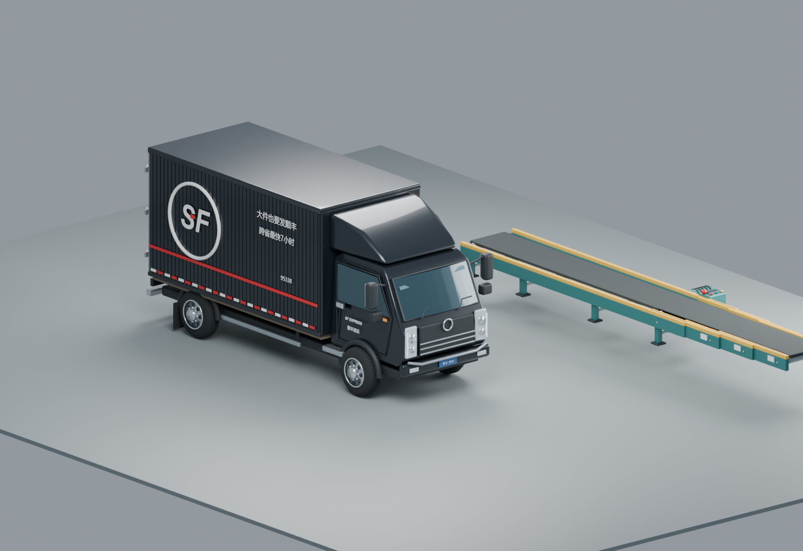
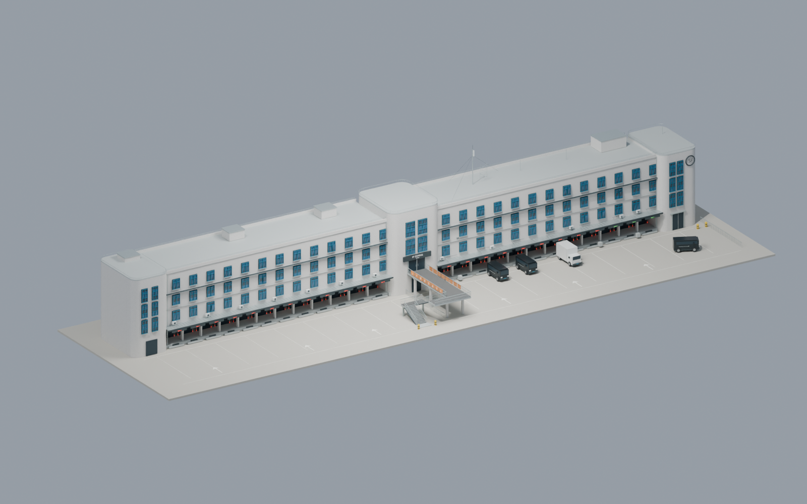
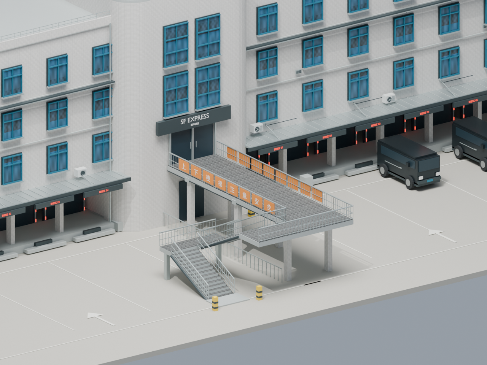

# 物流站 · 建筑外观与装卸作业模拟

根据原始建筑照片和两张天桥照片制作的三维外观模型，以及可交互的物流装卸示意动画。包含本地运行的网页、GLB 模型、Blender 源文件和生成脚本。

货车已按用户提供的顺丰实车照片精修：黑色厢式车身、导流罩、倾斜风挡、竖向灯组、轮胎纹路、轮毂螺母、门锁五金，以及 SF / 顺丰速运 / SF EXPRESS 标识、红色横线与反光条。传送带包含滚筒、三级套接框架、驱动电机、调平支脚、急停及控制盒。





## 新增左侧楼翼与中间天桥

原有右侧楼翼保留，按新增两张参考照片补建左侧楼翼、圆角中间入口、双列蓝色高窗、SF EXPRESS 入口牌、架空人行桥与楼梯。桥面加入菱形防滑铺装、不锈钢栏杆和橙色提示牌。原先右侧单体扩大为约 135 米总立面的双翼模型，所有尺寸均为估算。

- 开发页面增加“全楼总览 / 右侧楼翼 / 左侧楼翼 / 天桥楼梯”视角，保留作业控制面板。
- 左侧雨棚灯、办公室窗光和入口照明接入已有昼夜系统；全楼视角与阴影范围一并调整。
- 右侧 07 号月台装卸流程保留；驶入起点向右移开，使货车绕开新天桥及楼梯。
- 新照片并入仓库：`reference-right-bridge.jpg` 对应第一张右侧照片，`reference-left-bridge.jpg` 对应第二张左侧照片。模型、Blender 源文件和生成脚本同步更新。
- 两张照片不能确定完整平面：目前采用两翼沿同一主立面连接的近似布局；天桥长度、桥面高度、楼梯下半段与折返平台按照片推定，后续可用平面图或地面照片修正。



## 克隆后直接查看

需要 Node.js 20 或更新版本，以及支持 WebGL 的现代浏览器。查看现成模型无需安装 Blender，无需 API Key，无需运行建模脚本，也无需 `npm install` 或构建。

```sh
git clone https://github.com/Cedric0927/logistics-building-3d.git
cd logistics-building-3d
npm start
```

打开 **http://127.0.0.1:4176/**。

- 默认展示货车装卸作业：驶入 → 靠台开门 → 传送带伸入车厢 → 纸箱直接输送入厂房分拨线 → 收带关门 → 驶离。一轮 80 秒，12 件纸箱。
- 点击“开始作业”，支持暂停 / 继续、重置、下一阶段、0.5×–4× 速度和拖动时间轴回看。
- 可切换场院全景、装卸近景和俯视动线，支持鼠标旋转、缩放和平移。
- 新增“货车细节”和“传送带细节”视角。车辆视角显示完整品牌涂装，设备视角自动开启车厢剖视，查看伸缩结构与输送过程。
- 可切换车厢剖视，查看货物状态；可勾选循环演示。空格键暂停 / 继续，R 重置。
- 新增白天 / 黄昏 / 夜间预设和 0–24 点时间滑杆，可独立于装卸动画调节光照；勾选“自动昼夜”后约 120 秒循环一天。天空、太阳方向、环境光、月台灯、庭院灯、车灯和部分办公室窗光随时间过渡。
- 原始建筑查看器保留在 `building.html`，支持 GLB 下载、打开其他 GLB、正面与屋顶视角。

请通过本地服务器访问，直接双击 HTML 会受到浏览器本地文件限制。若 4176 端口已被占用，可指定其他端口：

```powershell
# Windows PowerShell
$env:PORT=4177
npm start
```

```sh
# macOS / Linux
PORT=4177 npm start
```

网页查看组件、模型、贴图和照片全部包含在仓库中。克隆完成后，查看模型不依赖网络、CDN 或外部服务。可以把整个目录放到静态 Web 服务器中展示；GitHub 仓库文件页面本身不会执行网页。

## 只嵌入场景画面

开发演示入口仍为 `index.html`。产品嵌入入口为 **`preview.html`**，全屏铺满 iframe，隐藏设置、进度、按钮、下载链接和场景标签；默认自动、循环播放，保留鼠标旋转缩放。页面初始即隐藏开发界面，加载失败时显示必要的错误提示。

克隆后运行 `npm start`，打开 `http://127.0.0.1:4176/preview.html` 查看纯画面，打开 `embed-example.html` 查看实际嵌入示例。

集成到自己的项目（React / Vue / 普通 HTML 均可）：将仓库静态文件复制到自己项目的 `public/logistics/`，保持目录结构，至少包含 `preview.html`、`index.html`、`app.mjs`、`simulation.mjs`、`lighting.mjs`、`light-cycle.mjs`、`simulation.css`、两个 `.glb` 和 `vendor/three/`。无需复制 Blender 源文件、照片或开发脚本。

```html
<iframe
  src="/logistics/preview.html?hour=22&autoplay=1&loop=1"
  title="物流分拨区三维场景"
  style="display:block;width:100%;height:600px;border:0"
  loading="lazy"
></iframe>
```

React JSX 中将 style 换为 `style={{ width: '100%', height: 600, border: 0 }}`。iframe 自动适配容器；父项目必须给出非零高度。直接使用 iframe 可隔离 Three.js 版本与 CSS，无需把开发界面接入父项目。

| URL 参数 | 默认值 | 用途 |
| --- | --- | --- |
| `hour` | `12` | 0–24 点光照，22 为夜景 |
| `autoplay` | `1` | 0 为停在指定作业时刻 |
| `loop` | `1` | 0 为只播放一轮 |
| `time` | `0` | 初始作业秒数，0–80；40 为卸货阶段 |
| `speed` | `1` | 作业速度，0.25–4 |
| `view` | `overview` | overview / right / left / bridge / dock / truck / equipment / top |
| `autoLight` | `0` | 1 开启自动昼夜 |
| `interactive` | `1` | 0 禁止鼠标操作，仅播放画面 |

例如静态夜间卸货特写：`preview.html?hour=22&time=40&autoplay=0&view=dock`。也可直接使用 `index.html?embed=1` 加以上参数。未识别的视角及无效数字回退到默认值，数字越界时限制到支持范围。

集成后由对方项目的 HTTP 静态服务提供这些文件，不需要运行本仓库的 Node 服务。GitHub 仓库地址不能直接作为 iframe 的 src；需先部署到自己的静态站点或项目服务。若使用跨域 iframe，宿主 CSP 的 frame-src、场景服务的 frame-ancestors / X-Frame-Options 应允许对应嵌入；本地 serve.mjs 不设置禁止嵌入的响应头。

## 包含的文件

| 文件 | 用途 |
| --- | --- |
| `index.html` | 与本地预览一致的交互网页 |
| `app.mjs` / `simulation.css` | Three.js 作业场景、可运动设备及控制面板 |
| `lighting.mjs` / `light-cycle.mjs` | 场景灯具和连续昼夜光照曲线 |
| `lighting.test.mjs` | 昼夜边界、光照范围及时间格式测试 |
| `simulation.mjs` | 可回放的确定性作业时间轴 |
| `simulation.test.mjs` | 货物守恒、作业顺序与边界连续性测试 |
| `refined-equipment.glb` / `.blend` | 精修车辆与传送带；包含独立车轮、车门、车厢面板及伸缩段 |
| `create-equipment.py` | Blender 精修设备生成脚本 |
| `equipment-preview.png` / `equipment-info.json` | 设备渲染及规模说明 |
| `building.html` | 原始静态建筑查看器 |
| `logistics-building.glb` | 约 8.1 MB 的网页模型，内嵌贴图 |
| `logistics-building.blend` | 可编辑 Blender 源文件 |
| `reference.jpg` | 用户提供的建模参考照片 |
| `building-preview.png` | 模型渲染预览 |
| `create-building.py` | Blender 建模、导出和渲染脚本 |
| `facade-tiles.png` / `glass-reflection.png` | 脚本生成的材质贴图 |
| `building-info.json` | 模型规模与估算尺寸说明 |
| `vendor/` | Three.js 0.186.1 与 model-viewer 4.4.0 组件及许可证 |
| `asset-manifest.json` | 展示文件 SHA-256 校验值 |

## 验证克隆是否完整

```sh
npm test
```

检查展示文件的 SHA-256、GLB 文件头和长度、嵌入贴图，以及网页引用的本地素材；随后检查 12 件货物守恒、输送时停稳开门与传送带完全伸出、货物流向厂房、清带后收回、阶段连续与回放重置。

## 动画范围

建筑 GLB 复用已有资产，网页加载时移除原有四辆静态车辆，加载 Blender 导出的精修设备 `refined-equipment.glb`，将其中两辆原有停放车辆替换为同款精修顺丰货车，并添加 12 件纸箱。两辆停放货车保持关门静止，独立于 07 号月台的动画和剖视。传送带从月台伸入车厢，纸箱依次上带并直接进入室内分拨线，计数在进入室内后增加；卸空并清带后收回传送带，再关闭车门。时间轴拖回任意位置都可恢复状态。设备的造型、品牌文字与五金由 Blender 制作，网页控制其独立命名部件；纸箱与活动带面标记由 Three.js 生成。建筑与设备分别提供 `.blend` / `.glb` 文件，完整装卸流程由网页代码驱动。

可选重新生成设备：`blender --background --factory-startup --python create-equipment.py`。设备尺寸和涂装按单张照片近似，不是指定车型的工程模型；顺丰元素为对用户参考图的外观重建。

昼夜为展示用的美术光照，没有按真实地理位置、日期计算天文日出日落。夜间灯具和窗光由网页生成，Blender 文件保留原始设备与建筑。

这是单车、单月台的作业示意。转向、速度与纸箱上带动作经过简化，没有车辆动力学、碰撞避让或多车调度。

## 可选：重新生成模型

现成模型由 Blender 5.2.2 LTS 生成。若要修改并重新生成，安装 Blender 后运行：

```sh
blender --background --factory-startup --python create-building.py
```

脚本会覆盖同目录的模型、材质图和渲染图。中文灯牌需要中文字体：Windows 会尝试微软雅黑 / 黑体，macOS 会尝试苹方，Linux 会尝试 Noto CJK。也可指定字体：

```sh
blender --background --factory-startup --python create-building.py -- --font /path/to/chinese-font.ttf
```

若没有中文字体，脚本使用英文装卸口标识。重新生成后如要更新文件校验值，运行 `node verify.mjs --update`。

## 复原范围

重点复原左右楼翼、三排蓝色窗框、连续装卸口、编号灯牌、雨棚与支架、中间圆角入口、人行天桥、栏杆及楼梯，保留右侧精修货车与装卸作业。静态建筑查看器内的车辆仍为简化陪衬。背面、进深和尺寸来自推测，未还原室内与人物；这是用于网页展示的外观近似模型，不是测绘或施工模型。

第三方组件信息见 [THIRD_PARTY_NOTICES.md](THIRD_PARTY_NOTICES.md)。
